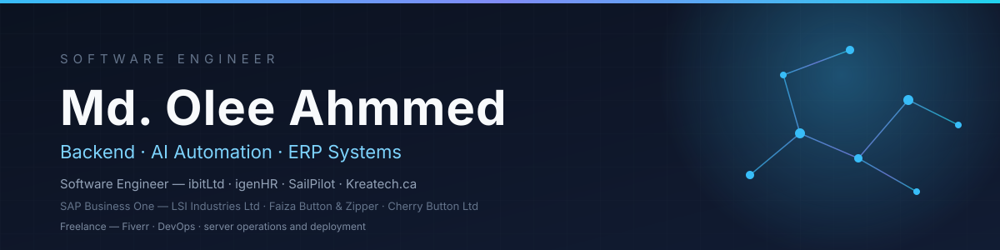

  

  
  
  
  

I build backend systems and AI automation for software that has to work every day. Ten years into this field, I have delivered 400+ projects across ERP, inventory, custom platforms and web — most of them as the lead, from data model to deployment and production support.

Since 2022 I have worked as a Software Engineer at Kreatech.ca and ibitLtd — and with ibitLtd's partner companies igenHR and SailPilot — building backend services, DevOps and deployment, and platforms for US clients, including a campaign system sending 20M+ SMS every month, banking automation, loan verification and IoT integrations.

Experience	Projects delivered	Peak message volume	Public repositories
10+ years	400+	20M+ / month	140+

Engineering focus

Software Engineer — ibitLtd, working with partner companies igenHR and SailPilot; also Kreatech.ca.

Backend engineering, DevOps and AI automation since 2022 — shipping multi-agent systems with CrewAI, LangGraph, LangChain and Hermes while keeping production platforms stable.

Experience

A decade across three kinds of work: building software products, implementing the ERP that runs the business, and keeping deployments alive.

Software engineering · 2022 – Present

Company	Role	Focus
ibitLtd	Software Engineer	AI automation, backend and production systems
igenHR	Software Engineer · ibitLtd partner	HR platform engineering
SailPilot	Software Engineer · ibitLtd partner	Product and backend engineering
Kreatech.ca	Software Engineer	Backend, DevOps and platforms for US clients
